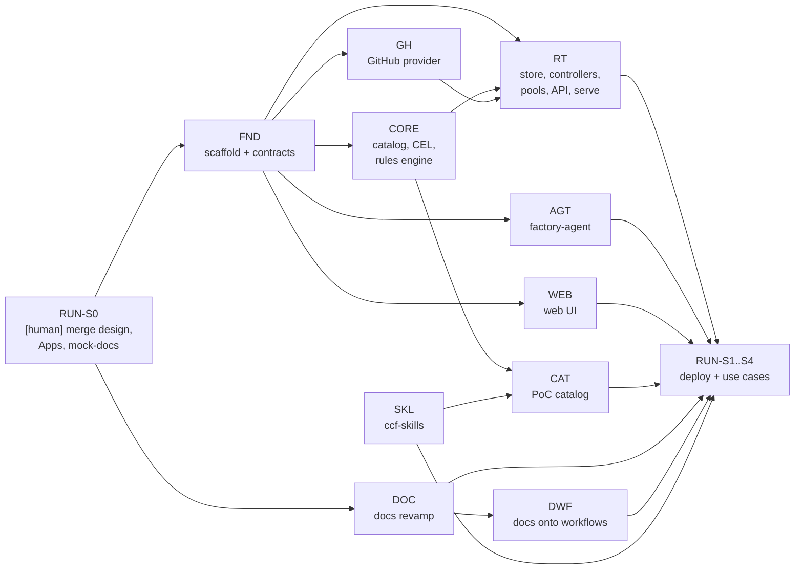

# CCF Factory PoC: workstream definitions

> Status: **draft for discussion** · Last updated: 2026-10-15 · Design: [`design/`](../README.md) · PoC scope: [10-poc.md](../10-poc.md)

This file breaks the PoC ([08-roadmap.md](../08-roadmap.md)) into tasks that agents run with **`lisa`** and review with **`ccf-review`**, one repo (or one PR stack) per agent. Each workstream has a **Low Level Design** in `design/workstreams/<name>/LLD/`. The task specs below say *what* to do and *when it's done*; the LLD says *how*.

## Workstreams

| Code | Workstream | Repo(s) | LLD | Side |
|---|---|---|---|---|
| FND | [Foundation](#fnd-foundation): repo scaffold, CI, contracts (Go types, JSON Schemas, OpenAPI) | `factory` | [foundation/LLD](foundation/LLD/) | shared |
| CORE | [Dispatcher core](#core-dispatcher-core): catalog, CEL, patterns, rule engine | `factory` | [dispatcher-core/LLD](dispatcher-core/LLD/) | backend |
| RT | [Dispatcher runtime](#rt-dispatcher-runtime): store, controllers, scheduler and pools, API server, `factory serve` | `factory` | [dispatcher-runtime/LLD](dispatcher-runtime/LLD/) | backend |
| GH | [GitHub provider](#gh-github-provider): App auth, webhooks, normalisation, observe, projection, effects | `factory` | [provider-github/LLD](provider-github/LLD/) | backend |
| AGT | [Agent](#agt-agent): `factory-agent` worker, run pipeline, Codex and Claude Code adapters, Effector | `factory` | [agent/LLD](agent/LLD/) | backend |
| WEB | [Web UI](#web-web-ui): Vue app embedded in the dispatcher binary | `factory` (`web/`) | [web-ui/LLD](web-ui/LLD/) | **frontend** |
| CAT | [PoC catalog](#cat-poc-catalog): providers, task specs, prompts, templates, rule packs, RuleSets, fixtures | `factory` (`catalog/`) | [catalog-poc/LLD](catalog-poc/LLD/) | content |
| SKL | [ccf-skills bump](#skl-ccf-skills-bump): opt-in headless mode, new docs and factory skills, review rule packs | `ccf-skills` | [ccf-skills/LLD](ccf-skills/LLD/) | skills |
| DOC | [Docs revamp](#doc-docs-revamp): per-repo versioned instances, catalog, OpenAPI, baseline content, `mock-docs` | `docs`, `mock-docs` | [docs-revamp/LLD](docs-revamp/LLD/) | docs |
| DWF | [Docs onto shared workflows](#dwf-docs-onto-shared-workflows): shared CI, Renovate, ccf-bump, repo settings (no release train) | `workflows`, `mock-docs`, `docs` | [docs-workflows/LLD](docs-workflows/LLD/) | CI |
| RUN | [PoC rollout](#run-poc-rollout): Apps, hosting, agents, runbooks for both use cases | `factory` + `[human]` | [poc-rollout/LLD](poc-rollout/LLD/) | ops |

### Backend and frontend run separately

All factory code lives in `compliance-framework/factory` ([repo layout](foundation/LLD/repo-layout.md)). Backend and frontend workstreams never block each other:

- **The contract is the boundary.** `api/openapi.yaml` (FND) is the only coupling. The backend generates its server and client from it; the frontend generates its TypeScript client from it and develops against **MSW mocks** of it. A contract change is always its own small PR, merged first.
- **Separate trees, separate toolchains.** Backend: `cmd/`, `internal/` (Go). Frontend: `web/` (Node, own `package.json`). No PR touches both, except the FND scaffold.
- **One binary at the end.** `make web` builds `web/` into `internal/webui/dist`, and `go build -tags webui` embeds it with `go:embed`. Without the tag, a placeholder page is embedded, so backend work never needs Node.
- **Separate CI jobs**, path-filtered: `go` (on `cmd/`, `internal/`, `api/`, `catalog/`) and `web` (on `web/`, `api/openapi.yaml`).

## Dependencies



| Stage | Step | Runs in parallel | Needs |
|---|---|---|---|
| **A** | A1 | RUN-S0-T01 `[human]` (design merged) · RUN-S0-T02/T03 `[human]` · SKL-S1 · DOC-S1-T01, DOC-S1-T02 | nothing |
| | A2 | FND · DOC-S1-T03…T05 | FND: RUN-S0-T01 · DOC: DOC-S1-T02 |
| | A3 | SKL-S2 | SKL-S1-T01, DOC-S1-T02 (`instances.yaml` format) |
| **B** | | CORE · GH · AGT · WEB · RT-S1 (store, controller runtime) · DWF-S1 · DOC-S2 | FND (factory tasks); DOC-S1-T01 (DWF-S1-T01); RUN-S0-T03 + DOC-S1-T05 (DOC-S2, DWF-S1-T02/T03) |
| **C** | | RT-S2 (rule/work-item controllers, pools, API, serve) · CAT · SKL-S3 · DWF-S2 | per task: CORE-S1-T04 + RT-S1-T02 (RT-S2-T01); GH-S1-T04 + RT-S2-T03 (RT-S2-T04); CORE-S1-T03 + SKL-S3-T02 (CAT) |
| **D** | | RUN-S1…S4: deploy, register agents, use case 1 (mock-docs → docs), human-PR review, use case 2, enable merge, put the factory on the release train | everything above |

Each task's `Depends:` line is authoritative; the table is the overview.

## How to run a task with lisa

Each task is a `### <ID>` section that holds everything an agent needs: repo, branch, base, stack, dependencies, LLD, spec and done criteria. Extract it into its own spec file and run lisa on it:

```bash
TASK=CORE-S1-T04; FILE=design/workstreams/definitions.md
awk -v id="### $TASK " 'index($0,id)==1{f=1;print;next} f&&/^### /{f=0} f' "$FILE" > "/tmp/$TASK.md"
```

```text
/lisa compliance-framework/<repo> <branch> /tmp/<TASK>.md
```

- **Reading an extracted task.** Links in a task are relative to `design/workstreams/` in the `factory` repo. A task without a `Repo:` line uses the repo of the first task in its stack.
- **LLDs are part of the spec.** For `factory` tasks, the LLD is in the clone, so read it. For `ccf-skills`, `docs`, `mock-docs` and `workflows` tasks, fetch it: `gh api repos/compliance-framework/factory/contents/<path> --jq .content | base64 -d`.
- **Stacks.** Tasks with the same `Stack:` value land as one `gh stack` in one repo, in the order listed. lisa opens **one PR per run**, so build a stack one layer at a time:
  - Run the bottom task as **"one-shot"**.
  - For each next task, set `LISA_BASE=<branch below>` and run it "one-shot".
  - Watch the stack by running lisa once on the **top** PR. It fixes threads bottom-up and keeps one cron for the whole stack.
  - Keep stacks linear. Merge bottom-up.
- **Parallel stacks in `factory`** (CORE, GH, AGT, WEB, RT, CAT) each branch from `main` and mostly touch disjoint directories (see each workstream's *Owns* line). The exceptions are the **shared entrypoints**:
  - `cmd/factory/main.go` (subcommand registration): touched by FND (creates it), CORE (`validate`, `rules test`) and RT (`serve`, `dispatch`).
  - `cmd/factory-agent/main.go`: touched by FND (creates it) and AGT (every subcommand).
  - `go.mod`/`go.sum`: any stack adding a dependency.

  Each subcommand lives in its own file (`cmd/factory/validate.go`, `serve.go`, …) and registers itself with one line in `main.go`, which keeps conflicts to a single line. **Merge order for these files:** FND first; then CORE before RT; AGT whenever it's ready. The stack merging later rebases on `main` and keeps both registrations. `go.mod` conflicts are resolved with `go mod tidy` after rebasing, never by hand.
- **Identity.** Run lisa as your own `gh` identity, or as `ccf-lisa[bot]`. **Never** as `ccf-release-bot` or the factory's own Apps.
- **`[human]` tasks** need an org owner: GitHub Apps, secrets, repo creation, repo settings, hosting, agent machines. Agents never do these.

## How to review with ccf-review

Every PR gets `/ccf-review:review <PR URL>` before merge, and `--again` after new commits. lisa's self-review already applies the same rule catalog.

| Repo | Rule packs |
|---|---|
| `factory` (Go) | `core`, `go`, then `repo/factory` once SKL-S3-T01 lands |
| `factory` (`web/`) | `core`, `vue-app` |
| `factory` (`catalog/`) | `core`, then `repo/factory` (catalog rules) |
| `ccf-skills` | `core`, `skills-repo` |
| `docs`, `mock-docs` | `core`, then `docs-site` once SKL-S3-T01 lands |
| `workflows` | `core` (its existing conventions; see its README) |

**Questions** from ccf-review go to a human, as ccf-review requires. A PR merges when ccf-review has no open must-fix findings, CI's required check is green, and a maintainer approves.

## Conventions for every PR

- **Title:** a conventional commit, e.g. `feat(rules): rule engine`. It becomes the squash commit.
- **Branch:** `fx/<task-id-lowercase>-<slug>`, e.g. `fx/core-s1-t04-rule-engine`.
- **Body:** links the design and LLD, names the task ID, lists what was verified locally, and ends with the session's attribution line.
- **Licence headers:** none per file. The repo `LICENSE` is AGPL-3.0.
- **Don't change behaviour beyond the task.** Follow-ups get their own PR.
- **Never commit** secrets, App private keys, `.env` files, `auth.json`/harness credentials, `go.work`, `web/node_modules` or build outputs (except the committed placeholder page).
- **Tests:** every Go package ships table-driven unit tests, and `go test -race ./...` passes. Web changes ship Vitest specs. Integration points use fakes defined in the LLDs.

---

## FND: foundation

**Goal.** A buildable `factory` repo with CI, the layout every other workstream builds in, and the **contracts** they code against.
**Owns:** repo root files, `.github/`, `Makefile`, `internal/apis/`, `api/`, `schemas/`, `internal/webui/` (placeholder), `internal/provider/` (the interface; `github/` and `tokens/` are GH's), `internal/provider/fake/`.
**LLD:** [repo-layout.md](foundation/LLD/repo-layout.md), [contracts.md](foundation/LLD/contracts.md).

### FND-S0-T01 `chore: scaffold the factory repo`

- **Repo:** factory · **Branch:** `fx/fnd-s0-t01-scaffold` · **Base:** `main` · **Stack:** `fnd` · **Depends:** RUN-S0-T01 (design merged)

**Spec.** Create the layout in [repo-layout.md](foundation/LLD/repo-layout.md):

- `go.mod` (`github.com/compliance-framework/factory`, Go 1.26) and empty `cmd/factory` and `cmd/factory-agent` mains that print their version.
- `Makefile` with the targets in the LLD (`build`, `test`, `lint`, `reviewable`, `generate`, `web`, `build-release`).
- No `.golangci.yml`: like `api`, lint with the shared CCF config from `compliance-framework/workflows`.
- `internal/webui` with the two build-tagged embed files and the committed placeholder page.
- `web/.gitkeep`, `LICENSE` (AGPL-3.0 full text), `README.md`, `AGENTS.md` and `CLAUDE.md` (pointing at `AGENTS.md`), and `.gitignore` (must ignore `deploy/poc/.env`, `.env*` except `*.env.example`, `internal/webui/dist/`, `web/node_modules/`, `bin/`). The dispatcher host already has secrets in `deploy/poc/.env`, protected today by an untracked local `.gitignore`: remove that local file before pulling this scaffold.

**Done when:** `make reviewable` passes locally, and both binaries build with and without `-tags webui` (the latter after `mkdir -p internal/webui/dist && cp internal/webui/placeholder/index.html internal/webui/dist/`).

### FND-S0-T02 `ci: CI for Go and web`

- **Branch:** `fx/fnd-s0-t02-ci` · **Base:** `fx/fnd-s0-t01-scaffold` · **Stack:** `fnd`

**Spec.** Add `.github/workflows/ci.yml`:

- **`go`:** calls `compliance-framework/workflows` `ci-go-service.yml`, pinned `@<sha> # vX.Y.Z`. If that workflow can't run in a repo that also has `web/`, use a local job with the same steps.
- **`web`:** a local job, path-filtered to `web/**` and `api/openapi.yaml`, running `npm ci && npm run reviewable` in `web/`. It's skipped while `web/package.json` doesn't exist.
- **`required`:** aggregates both and must report on **every** PR, even when path filters skip `go` or `web`. It has `needs: [changes, go, web]` and `if: always()`. It fails only when a needed job's result is `failure` or `cancelled`; `skipped` counts as success. Branch protection requires only `required`.
- Add `notify-failure.yml` like the other repos.
- Follow `CORE-CI-001`: actions pinned by SHA, top-level `permissions: contents: read`, `persist-credentials: false`.

**Done when:** the PR's `required` check is green. Two throwaway test PRs (a Go-only change and a web-only change) each show one job skipped and `required` **green and reported**. A deliberately failing job turns `required` red.

### FND-S1-T01 `feat(apis): v1alpha1 types and JSON Schemas`

- **Branch:** `fx/fnd-s1-t01-apis` · **Base:** `fx/fnd-s0-t02-ci` · **Stack:** `fnd`

**Spec.**

- Implement every kind in [contracts.md §Go types](foundation/LLD/contracts.md#go-types) under `internal/apis/v1alpha1`:
  - config kinds: Provider, Group, Template, Rule, RuleSet, TaskSpec, Queue, Pool;
  - runtime kinds: Event, WorkItem, Task, Run, Agent, Effect, Approval (type only);
  - Result, capability descriptors, the event vocabulary constants and the effect-op constants.
- Strict YAML decoding (unknown fields are errors).
- `make schemas` generates `schemas/*.schema.json` from the types. CI fails if they're stale.

**Done when:** round-trip tests (YAML → struct → YAML) pass for every example in [03](../03-domain-model.md) and [10](../10-poc.md), and the schemas are committed and fresh.

### FND-S1-T02 `feat(api): OpenAPI contract and generated code`

- **Branch:** `fx/fnd-s1-t02-openapi` · **Base:** `fx/fnd-s1-t01-apis` · **Stack:** `fnd`

**Spec.**

- Write `api/openapi.yaml` exactly as [contracts.md §HTTP API](foundation/LLD/contracts.md#http-api): agent, lease, effector, resources, commands, events (SSE), auth and webhooks.
- Generate the Go **Echo strict** server interface and the client with `oapi-codegen` (`internal/apiserver/gen`, `internal/apiclient`) via `make generate`. CI fails if generated code is stale.
- Add a tiny `cmd/factory-mock` (plain `net/http`, no Echo) that serves the contract with canned responses from `api/examples/`. Agent and web developers can use it before RT exists.

**Done when:** the spec lints clean (`redocly lint` or `vacuum`), generation is reproducible, and `factory-mock` answers every operation with its example.

### FND-S1-T03 `feat(provider): Provider interface and fake`

- **Branch:** `fx/fnd-provider-interface` · **Base:** `fx/rt-s1-t02-controller-runtime` · **Stack:** `rt` · **Status:** ✅ done by this PR

**Spec.** A contract gap: [contracts.md §Provider interface](foundation/LLD/contracts.md#provider-interface) defines `internal/provider` and `provider/fake`, but no task built them, and RT-S2-T01 (controllers) and GH-S1 (the GitHub adapter) both code against them.

- `internal/provider`: `Adapter`, `Conn`, `IngressSink`, `Projection` exactly as in contracts.md, every type they reference (v1alpha1 types wherever they fit), and a `Registry` from Provider type to adapter.
- `internal/provider/fake`: in memory and concurrency-safe; seeded objects for `Observe` and `List`, recorded `Project` and `Apply` calls (idempotency-key replay), scripted deliveries into an `IngressSink` normalised into Events, `ResolveGroup` from configured membership, fake git tokens, health, a webhook `Handler` and `Recover`.
- Record each refinement in [contracts.md §Refinements](foundation/LLD/contracts.md#refinements-fnd-s1-t03).

**Done when:** `go test -race ./internal/provider/...` passes, the interface matches contracts.md with its documented refinements, and the GH LLD's adapter can implement it as written.

---

## CORE: dispatcher core

**Goal.** The pure, side-effect-free heart: load and validate a catalog, and decide what to do for an event.
**Owns:** `internal/catalog/`, `internal/cel/`, `internal/patterns/`, `internal/rules/`, `cmd/factory` subcommands `validate` and `rules test`.
**LLD:** [catalog.md](dispatcher-core/LLD/catalog.md), [cel-and-expressions.md](dispatcher-core/LLD/cel-and-expressions.md), [patterns.md](dispatcher-core/LLD/patterns.md), [rules-engine.md](dispatcher-core/LLD/rules-engine.md).

### CORE-S1-T01 `feat(patterns): harness config patterns and resolution`

- **Repo:** factory · **Branch:** `fx/core-s1-t01-patterns` · **Base:** `main` · **Stack:** `core` · **Depends:** FND-S1-T01

**Spec.** Implement [patterns.md](dispatcher-core/LLD/patterns.md): the matcher (exact, glob with `*` `?` `{a,b}`, `re:` regex, `*`, lists), `Resolve(constraint, request, offer)`, and the `prefer`, default and highest-version tie-breaks. Include effort resolution.

**Done when:** the LLD's resolution table is covered by table tests, including the no-match case.

### CORE-S1-T02 `feat(cel): CEL environment and runtime expressions`

- **Branch:** `fx/core-s1-t02-cel` · **Base:** `fx/core-s1-t01-patterns` · **Stack:** `core`

**Spec.** Implement [cel-and-expressions.md](dispatcher-core/LLD/cel-and-expressions.md):

- the typed environment (`event`, `actor`, `item`, `run`, `approval`, `provider`, `params`, `inputs`, `task`, `now`) and the custom functions;
- compile-once caching and cost limits;
- `=`-prefixed value evaluation over YAML trees;
- `{{ params.x }}` substitution at load.

**Done when:** every `where` and `=` expression in [10](../10-poc.md) compiles against the environment in a test, and runtime errors become typed errors (never panics).

### CORE-S1-T03 `feat(catalog): loader, validation and factory validate`

- **Branch:** `fx/core-s1-t03-catalog` · **Base:** `fx/core-s1-t02-cel` · **Stack:** `core`

**Spec.** Implement [catalog.md](dispatcher-core/LLD/catalog.md):

- load a directory or a git ref into an immutable `Catalog` snapshot with its SHA;
- run all validation phases (schema, references, CEL compile, `=` expressions, params and overrides, inputs against `TaskSpec.inputs`, provider and event-vocabulary compatibility, patterns against adapter capability descriptors, `stateKeys`, excludes);
- report errors with `file:line` and a stable code;
- add `factory validate [--dir catalog] [--capabilities caps.json]`.

**Done when:** the PoC catalog in [10](../10-poc.md) (copied into `internal/catalog/testdata/poc`) validates, and each validation phase has a failing fixture with its expected error code.

### CORE-S1-T04 `feat(rules): rule engine`

- **Branch:** `fx/core-s1-t04-rule-engine` · **Base:** `fx/core-s1-t03-catalog` · **Stack:** `core`

**Spec.** Implement [rules-engine.md](dispatcher-core/LLD/rules-engine.md): `Engine.Evaluate(ctx, Catalog, Event, WorkItemView, Rails) → Evaluation`. It covers:

- RuleSet scoping (provider events by binding and scope; `factory.*` events by linked objects);
- `on`/`where` matching, `priority` and `final`;
- dedupe per (event, rule);
- ordered actions with state visible to later actions and later rules;
- decisions for `dispatch`, `set`, `notify`, `cancel`, `link`, `effect` and `requestApproval`;
- debounce intents;
- rail verdicts through the injected `Rails` interface.

**No I/O.**

**Done when:** the cascade examples in [04](../04-flows.md#how-rules-cascade) and every PoC rule in [10](../10-poc.md) have engine tests asserting the exact decisions.

### CORE-S1-T05 `feat(rules): factory rules test`

- **Branch:** `fx/core-s1-t05-rules-test` · **Base:** `fx/core-s1-t04-rule-engine` · **Stack:** `core`

**Spec.** Add `factory rules test [--catalog dir] [--fixtures dir] [--update]` per [rules-engine.md §Fixtures](dispatcher-core/LLD/rules-engine.md#fixtures-and-factory-rules-test). It replays fixture events against a catalog, compares decisions with golden files, prints a decision diff, and exits non-zero on mismatch. `--base-catalog` prints the decision diff between two catalogs, for catalog PRs.

**Done when:** golden tests pass, and a deliberately changed rule produces a readable diff.

---

## RT: dispatcher runtime

**Goal.** The running dispatcher: state, controllers, queues and registered pools, the HTTP API, and `factory serve`.
**Owns:** `internal/store/`, `internal/controllers/`, `internal/scheduler/`, `internal/server/`, `internal/auth/`, `cmd/factory serve`.
**LLD:** [store.md](dispatcher-runtime/LLD/store.md), [controllers.md](dispatcher-runtime/LLD/controllers.md), [scheduler-and-pools.md](dispatcher-runtime/LLD/scheduler-and-pools.md), [api-server.md](dispatcher-runtime/LLD/api-server.md).

### RT-S1-T01 `feat(store): watchable in-memory store with retention`

- **Repo:** factory · **Branch:** `fx/rt-s1-t01-store` · **Base:** `main` · **Stack:** `rt` · **Depends:** FND-S1-T01

**Spec.** Implement [store.md](dispatcher-runtime/LLD/store.md):

- the `Store` interface (get, list with selectors, watch, create, update with resourceVersion CAS, delete);
- per-key locks with lease semantics;
- the in-memory implementation with bounded watch buffers and resync;
- the retention sweeper (default 90 days for Runs, transcripts, Events, Effects).

**Done when:** the store passes a shared conformance test suite under `-race`. That suite is reusable for a Postgres store later.

### RT-S1-T02 `feat(controllers): controller runtime and catalog-sync`

- **Branch:** `fx/rt-s1-t02-controller-runtime` · **Base:** `fx/rt-s1-t01-store` · **Stack:** `rt`

**Spec.** Implement the controller runtime from [controllers.md §Runtime](dispatcher-runtime/LLD/controllers.md#controller-runtime): a keyed work queue, rate-limited retries, and `Reconcile(ctx, key)`. Add the **catalog-sync** controller: poll `main` of the configured catalog repo, load and validate with CORE, swap atomically, and keep the last good SHA on failure. Use a fake `CatalogSource` until CORE-S1-T03 merges, then wire the real loader.

**Done when:** tests show an atomic swap, the bad-catalog keeps-old behaviour, and the reported status.

### RT-S2-T01 `feat(controllers): rule, work-item and run controllers`

- **Branch:** `fx/rt-s2-t01-controllers` · **Base:** `main` (after RT-S1) · **Stack:** `rt-2` · **Depends:** CORE-S1-T04, RT-S1-T02

**Spec.** Per [controllers.md](dispatcher-runtime/LLD/controllers.md):

- **rule:** Events → engine → apply decisions to the store (Tasks, state, links), notifications through the Provider interface, and the built-in `factory` provider emitting `factory.*` events.
- **work-item:** projection writes, `Observe` merge, periodic resync, rebuild on start from `List` plus marker parsing.
- **run:** results, timeouts, cancellation, and `factory.run.completed`/`failed`.

Use the `fake` provider from contracts.md in tests.

**Done when:** a full cascade (`issue.opened` → triage Task → fake result → `factory.run.completed` → next rule) runs in an in-process test, and a restart test rebuilds state from fake projections.

### RT-S2-T02 `feat(scheduler): queues, registered pools and leases`

- **Branch:** `fx/rt-s2-t02-scheduler` · **Base:** `fx/rt-s2-t01-controllers` · **Stack:** `rt-2`

**Spec.** Implement [scheduler-and-pools.md](dispatcher-runtime/LLD/scheduler-and-pools.md):

- queue ordering, concurrency and budgets (runs, tokens, USD);
- agent registration (owner verification, Group membership, agent tokens);
- the long-poll lease matcher: harness, pattern resolution, `requires.labels`, **lending** limits, hours, throttling, author anti-affinity for `docs-review`, fairness;
- heartbeats, lease expiry, `abandon`, and the retry policy.

**Done when:** the LLD's matching table is covered by tests, plus a lease-expiry test and a lending-limit test.

### RT-S2-T03 `feat(server): HTTP API, auth and SSE`

- **Branch:** `fx/rt-s2-t03-server` · **Base:** `fx/rt-s2-t02-scheduler` · **Stack:** `rt-2`

**Spec.** Implement the generated Echo strict server interface on **Echo v4** per [api-server.md](dispatcher-runtime/LLD/api-server.md):

- agent and lease endpoints;
- the Effector API (allow-list, idempotency keys, `Effect` records, apply through the Provider);
- resource read endpoints, the command endpoints (which become `factory.command.*` events), and SSE progress;
- auth: agent bearer tokens, UI sessions via GitHub OAuth (org-admin check), webhook HMAC routes delegated to the provider;
- `/healthz`, `/readyz`, `/metrics`.

**Done when:** contract tests run the generated client against the server for every operation, and the auth negative tests pass.

### RT-S2-T04 `feat(cmd): factory serve`

- **Branch:** `fx/rt-s2-t04-serve` · **Base:** `main`, after the `gh` stack and the `rt-2` stack up to RT-S2-T03 have **both merged** (it's the integration point of the two stacks, so it's not stacked on either) · **Depends:** GH-S1-T04, RT-S2-T03

**Spec.** Per [api-server.md §serve](dispatcher-runtime/LLD/api-server.md#factory-serve): config from env and flags, wiring of the store, controllers, the GitHub provider, the scheduler, the server and the embedded UI (`internal/webui`), graceful shutdown, and structured logs (`slog`). Add `factory dispatch --event file.json` to inject a fake event through the API.

**Done when:** `factory serve` starts against a fake GitHub (`httptest`), accepts a recorded webhook, and a registered fake agent completes a task end to end in an integration test.

---

## GH: GitHub provider

**Goal.** The GitHub adapter: everything provider-specific, behind the `Adapter`/`Conn` interfaces from FND.
**Owns:** `internal/provider/github/`, `internal/provider/tokens/`.
**LLD:** [github-provider.md](provider-github/LLD/github-provider.md).

### GH-S1-T01 `feat(github): App auth and scoped token minting`

- **Repo:** factory · **Branch:** `fx/gh-s1-t01-auth` · **Base:** `main` · **Stack:** `gh` · **Depends:** FND-S1-T02

**Spec.** Two identities (`author`, `reviewer`) from the Provider object. Mint installation tokens **scoped to one repository** and to the task spec's permission subset, with a TTL of at most 1h, per [§Auth](provider-github/LLD/github-provider.md#auth-and-tokens). Cache per (identity, repo, permissions) until 5 minutes before expiry. Unscoped tokens are impossible by construction.

**Done when:** tests against `httptest` GitHub assert the `repositories` and `permissions` bodies, plus cache expiry.

### GH-S1-T02 `feat(github): webhook ingress and normalisation`

- **Branch:** `fx/gh-s1-t02-ingress` · **Base:** `fx/gh-s1-t01-auth` · **Stack:** `gh`

**Spec.** Per [§Ingress](provider-github/LLD/github-provider.md#ingress-and-normalisation):

- HMAC verification and delivery-id dedupe;
- the mapping table from GitHub events to neutral types and facts:
  - `issue.*` and `pr.*`;
  - `release.published` with `semver` and `previousTag`;
  - `deploy.*` linked by SHA;
  - train issues (`train:done`, the train state JSON);
- actor tier resolution (org `role: admin` → maintainer, author association, bots, factory identities).

**Done when:** recorded payloads in `testdata/` normalise to golden Events for every row of the mapping table.

### GH-S1-T03 `feat(github): observe, list and projection`

- **Branch:** `fx/gh-s1-t03-observe` · **Base:** `fx/gh-s1-t02-ingress` · **Stack:** `gh`

**Spec.** `Observe` (GraphQL: PR state, reviews with commit, unresolved threads, checks, labels, sub-issues), `List` over a scope, and projection writes (factory labels plus one upserted hidden marker comment per work item), per [§Observe](provider-github/LLD/github-provider.md#observe-list-and-projection).

**Done when:** golden tests cover observation parsing, and marker upsert is idempotent.

### GH-S1-T04 `feat(github): effects`

- **Branch:** `fx/gh-s1-t04-effects` · **Base:** `fx/gh-s1-t03-observe` · **Stack:** `gh`

**Spec.** Implement every effect op in [contracts.md §Effect ops](foundation/LLD/contracts.md#effect-ops) that lives on the API side, per [§Effects](provider-github/LLD/github-provider.md#effects). That covers comments, labels, issues, sub-issues, PR open/update/retarget/merge, reviews and threads. Every op uses an idempotency key (a hidden marker or a lookup before create), and retries back off on rate limits.

**Done when:** each op has an `httptest` test, and replaying the same idempotency key creates nothing new.

---

## AGT: agent

**Goal.** `factory-agent`: a registered worker that runs leased tasks with Codex or Claude Code, under the owner's local login.
**Owns:** `internal/agent/`, `cmd/factory-agent`.
**LLD:** [worker.md](agent/LLD/worker.md), [run-pipeline.md](agent/LLD/run-pipeline.md), [harness-adapters.md](agent/LLD/harness-adapters.md), [effector.md](agent/LLD/effector.md), [local-stack.md](agent/LLD/local-stack.md).

### AGT-S1-T01 `feat(agent): worker registration and lease loop`

- **Repo:** factory · **Branch:** `fx/agt-s1-t01-worker` · **Base:** `main` · **Stack:** `agt` · **Depends:** FND-S1-T02

**Spec.** Per [worker.md](agent/LLD/worker.md):

- the local config file (dispatcher URL, pool, join token, `lending`, labels, harness config dirs);
- `factory-agent worker` registration (owner identity from `gh auth token`), the long-poll lease loop, heartbeats, throttle reporting, and drain on SIGTERM;
- `factory-agent probe`, which prints capabilities.

Develop against `factory-mock` (FND-S1-T02).

**Done when:** an integration test against `factory-mock` registers, leases a canned task, heartbeats and completes it.

### AGT-S1-T02 `feat(agent): run pipeline`

- **Branch:** `fx/agt-s1-t02-pipeline` · **Base:** `fx/agt-s1-t01-worker` · **Stack:** `agt`

**Spec.** Per [run-pipeline.md](agent/LLD/run-pipeline.md):

- the scratch workspace;
- clones with an in-memory credential helper (rw repo with the scoped token; ro repos and `publicReads` anonymous);
- skills materialisation from `ccf-skills@commit`;
- prompt rendering (headless preamble, template, inputs, fenced untrusted context);
- the environment for the harness (`FACTORY_HEADLESS=1` and the rest);
- result validation with one repair turn, transcript upload, cleanup.

Use a **fake harness** adapter in tests.

**Done when:** the fake-harness pipeline test covers success, schema repair, a limit hit and cleanup on failure.

### AGT-S1-T03 `feat(agent): codex adapter`

- **Branch:** `fx/agt-s1-t03-codex` · **Base:** `fx/agt-s1-t02-pipeline` · **Stack:** `agt`

**Spec.** The `codex` adapter per [harness-adapters.md §Codex](agent/LLD/harness-adapters.md#codex): `Probe`, `Prepare` (scratch `CODEX_HOME` that reuses the owner's login, skills dir, `AGENTS.md`, MCP config) and `Run` (`codex exec --json`, stream parsing, rate-limit detection). **First verify every flag** marked *verify* in the LLD against the installed Codex, and record the result in the PR.

**Done when:** a parser test on recorded JSONL passes, and a smoke run (`make smoke-codex`, skipped in CI) completes a trivial task on a maintainer machine.

### AGT-S1-T04 `feat(agent): claude-code adapter`

- **Branch:** `fx/agt-s1-t04-claude` · **Base:** `fx/agt-s1-t03-codex` · **Stack:** `agt`

**Spec.** The `claude-code` adapter per [harness-adapters.md §Claude Code](agent/LLD/harness-adapters.md#claude-code): `--plugin-dir` skills, `--append-system-prompt`, `--mcp-config`, `--json-schema`, `--permission-mode` plus a `PreToolUse` hook for read-only workspaces, effort mapping, and stream-json parsing. Verify flags first, as in AGT-S1-T03.

**Done when:** the same as AGT-S1-T03, with `make smoke-claude`.

### AGT-S1-T05 `feat(agent): effector CLI and MCP server`

- **Branch:** `fx/agt-s1-t05-effector` · **Base:** `fx/agt-s1-t04-claude` · **Stack:** `agt`

**Spec.** Per [effector.md](agent/LLD/effector.md):

- `factory-agent fx <op> …` (the CLI on `PATH` as `factory`);
- `factory-agent mcp` (stdio MCP server, same ops);
- API-side ops through the Effector API with idempotency keys;
- git-side ops (`push-branch`, `stack.push`, `stack.rebase`) in the workspace with the scoped token, via `git` and `gh stack`;
- a local allow-list pre-check (the server stays authoritative).

**Done when:** each op is tested against `factory-mock`, and the MCP tool list matches the CLI.

### AGT-S1-T06 `feat(agent): local stack and media tooling`

- **Branch:** `fx/agt-s1-t06-local-stack` · **Base:** `fx/agt-s1-t05-effector` · **Stack:** `agt`

**Spec.** Per [local-stack.md](agent/LLD/local-stack.md):

- probes for `has-local-stack` (Docker plus a `local-dev` checkout) and `gif-tooling` (Playwright, gifski, vhs);
- `factory-agent stack up --versions file|--train ref`, `stack wait`, `stack down`, exposed to skills as a CLI;
- one stack per agent, enforced;
- version pinning through `local-dev` env overrides.

**Done when:** a dry-run test prints the exact compose environment for a sample train, and a manual run brings the stack up and down on a maintainer machine.

---

## WEB: web UI

**Goal.** The Factory UI, built in `web/` and embedded in the dispatcher.
**Owns:** `web/` only.
**LLD:** [web-ui.md](web-ui/LLD/web-ui.md).

### WEB-S0-T01 `feat(web): scaffold, typed client and mock API`

- **Repo:** factory · **Branch:** `fx/web-s0-t01-scaffold` · **Base:** `main` · **Stack:** `web` · **Depends:** FND-S1-T02

**Spec.** Per [web-ui.md §Stack](web-ui/LLD/web-ui.md#stack-and-layout), matching the conventions of `compliance-framework/ui`:

- Vue 3, Vite, TypeScript, Pinia, Vue Router, PrimeVue (unstyled, Volt) and Tailwind v4;
- `openapi-typescript` and `openapi-fetch` generated from `../api/openapi.yaml`;
- MSW handlers from `../api/examples`;
- Vitest and Playwright;
- `npm run reviewable`;
- `vite build` into `../internal/webui/dist`.

**Done when:** `npm run reviewable` passes, `npm run dev:mock` shows an empty shell with navigation, and `make build-release` embeds it.

### WEB-S1-T01 `feat(web): board and work item`

- **Branch:** `fx/web-s1-t01-board` · **Base:** `fx/web-s0-t01-scaffold` · **Stack:** `web`

**Spec.** The board (work items by state, with the `needs-human` lane on top, filters by RuleSet, provider and repo) and the work-item page (cross-provider timeline, state keys, and a **"why" panel** per decision showing the RuleSet, rule, `where` inputs and rail verdicts). See [web-ui.md §Views](web-ui/LLD/web-ui.md#views).

**Done when:** there are Vitest specs per component, and a Playwright test runs over MSW data.

### WEB-S1-T02 `feat(web): run view with live progress`

- **Branch:** `fx/web-s1-t02-run` · **Base:** `fx/web-s1-t01-board` · **Stack:** `web`

**Spec.** The run page: a live SSE progress stream (with reconnect and backfill), the transcript viewer, the effective harness config, usage, the effects performed (linked), and the agent and owner.

**Done when:** specs pass, including a mocked SSE stream test.

### WEB-S1-T03 `feat(web): queues, pools and agents`

- **Branch:** `fx/web-s1-t03-pools` · **Base:** `fx/web-s1-t02-run` · **Stack:** `web`

**Spec.** Queue depth and running and pending tasks with their reasons (`budget`, `no-capable-agent`, `agent-throttled`). Registered agents with capabilities, **lending**, state and throttle windows.

**Done when:** specs pass.

### WEB-S1-T04 `feat(web): catalog, controls and sign-in`

- **Branch:** `fx/web-s1-t04-catalog-controls` · **Base:** `fx/web-s1-t03-pools` · **Stack:** `web`

**Spec.**

- A read-only catalog browser: SHA, providers and their health, RuleSets with their selected rules, task specs, queues and pools.
- A rule dry-run against a pasted or recorded event.
- Controls, each confirmed in a dialog: pause and resume (global, provider, queue, item), cancel run, re-dispatch.
- GitHub OAuth sign-in and an org-admin-only guard for controls.

**Done when:** specs pass, and controls send the right command bodies (asserted on MSW).

---

## CAT: PoC catalog

**Goal.** The real `catalog/` for both use cases plus human-PR review, with fixtures that pin its behaviour.
**Owns:** `catalog/`.
**LLD:** [catalog-poc.md](catalog-poc/LLD/catalog-poc.md).

### CAT-S1-T01 `feat(catalog): providers, groups, queues and pools`

- **Repo:** factory · **Branch:** `fx/cat-s1-t01-base` · **Base:** `main` · **Stack:** `cat` · **Depends:** CORE-S1-T03

**Spec.** `providers/github-public.yaml`, `groups/maintainers.yaml` (`orgRole: admin`), `queues/poc.yaml` and `pools/local.yaml`, as in [10](../10-poc.md#provider-group-pool-queue). Use secret *references* only.

**Done when:** `factory validate` passes in CI (add the `catalog` CI step).

### CAT-S1-T02 `feat(catalog): task specs, prompts and templates`

- **Branch:** `fx/cat-s1-t02-taskspecs` · **Base:** `fx/cat-s1-t01-base` · **Stack:** `cat` · **Depends:** SKL-S3-T02 (the `ccf-skills` v0.8.0 tag that every TaskSpec pins; it includes the skill names from SKL-S2-T01…T04)

**Spec.** Five TaskSpecs (`release-docs`, `plan-epic`, `implement`, `docs-review`, `merge`), their prompt templates and result schemas, and four templates, per [catalog-poc.md §TaskSpecs and prompts](catalog-poc/LLD/catalog-poc.md#taskspecs-prompts-and-result-schemas). Pin `ccf-skills` to the SKL release tag.

**Done when:** validation passes, and the prompts render with fixture inputs in a test.

### CAT-S1-T03 `feat(catalog): rule packs and RuleSets`

- **Branch:** `fx/cat-s1-t03-rules` · **Base:** `fx/cat-s1-t02-taskspecs` · **Stack:** `cat`

**Spec.**

- Rule packs `release-docs`, `docs-epic`, `review-human` and the shared `escalate-needs-human`.
- RuleSets: `poc-release-docs`, `poc-docs-epic` and `poc-docs-human-review`, all targeting **`docs`**; and the **dev** RuleSets (`dev-release-docs`, `dev-docs-epic`), targeting **`mock-docs`** with mock trains, per [catalog-poc.md §Dev and prod RuleSets](catalog-poc/LLD/catalog-poc.md#dev-and-prod-rulesets).
- The `merge-*` rules stay **excluded**.

**Done when:** validation passes.

### CAT-S1-T04 `test(catalog): fixtures and golden decisions`

- **Branch:** `fx/cat-s1-t04-fixtures` · **Base:** `fx/cat-s1-t03-rules` · **Stack:** `cat` · **Depends:** CORE-S1-T05

**Spec.** `catalog/testdata/` with fake trains (patch-only, minor, mixed), human PRs (normal, draft, bot), the i18n epic cascade, and the hostile-input and loop-cap cases. Add golden decisions, and run `factory rules test` in CI.

**Done when:** CI runs the rules tests, and every rule in the PoC catalog is hit by at least one fixture (coverage printed).

---

## SKL: ccf-skills bump

**Goal.** Skills the factory can run unattended, on Codex and Claude Code, without changing interactive use, plus review rules for the new repos.
**Repo:** `compliance-framework/ccf-skills` · **LLD:** [headless-mode.md](ccf-skills/LLD/headless-mode.md), [docs-skills.md](ccf-skills/LLD/docs-skills.md), [factory-skills.md](ccf-skills/LLD/factory-skills.md), [review-rules.md](ccf-skills/LLD/review-rules.md).

### SKL-S1-T01 `feat: opt-in headless mode convention`

- **Repo:** ccf-skills · **Branch:** `fx/skl-s1-t01-headless` · **Base:** `main` · **Stack:** `skl-headless`

**Spec.** Per [headless-mode.md](ccf-skills/LLD/headless-mode.md):

- a `HEADLESS.md` convention at the repo root;
- the `FACTORY_HEADLESS=1` contract (never prompt; decide within effects or return `needs_input`; structured result file; Effector when `FACTORY_API` is set);
- a reusable "Headless mode" section snippet;
- the portability rules (no Claude-only features in the headless path).

**Done when:** README links the convention, and `ccf-review` with `skills-repo` rules passes.

### SKL-S1-T02 `feat(lisa,ccf-review): headless mode`

- **Branch:** `fx/skl-s1-t02-lisa-review` · **Base:** `fx/skl-s1-t01-headless` · **Stack:** `skl-headless`

**Spec.**

- **`lisa`:** in headless mode it's always one-shot with no `CronCreate`. It uses the Effector (`factory` CLI) when present, otherwise `lib/lisa`. It supports `LISA_BASE` stacks unchanged.
- **`ccf-review`:** headless triage decides automatically; Question findings → outcome `needs-human`; it publishes without confirmation, posts as the run's identity, and writes the result JSON.
- Interactive behaviour is unchanged (add regression notes).

**Done when:** both skills document the headless section, and an interactive dry run behaves exactly as before.

### SKL-S1-T03 `feat(resolve,ccf-test,sidebyside): headless mode`

- **Branch:** `fx/skl-s1-t03-others` · **Base:** `fx/skl-s1-t02-lisa-review` · **Stack:** `skl-headless`

**Spec.** The same convention for `resolve` (with tickets from GitHub issues when headless), `ccf-test` (with the API URL from the local stack) and `sidebyside` (with output paths given by the caller). `bugreport`, `bugfix`, `plugin` and `policy-review` are untouched in the PoC.

**Done when:** as SKL-S1-T02.

### SKL-S2-T01 `feat(ccf-docs): docs-style and docs-release`

- **Branch:** `fx/skl-s2-t01-docs-release` · **Base:** `main` · **Stack:** `skl-docs` · **Depends:** SKL-S1-T01, DOC-S1-T02 (`instances.yaml` schema)

**Spec.** A new plugin `ccf-docs` in the marketplace with `docs-style` and `docs-release`, per [docs-skills.md](ccf-skills/LLD/docs-skills.md):

- **`docs-release`:** reads the train (or a release), then per repo writes the section checklist (notes, API reference, config reference, guides, upgrade, catalog and policies rows), cuts the version per minor line, and keeps `instances.yaml` in sync.
- Its output matches `schemas/results/release-docs.json` in factory `catalog/`.

**Done when:** a dry run on a fixture train against a `mock-docs` checkout produces the expected file set.

### SKL-S2-T02 `feat(ccf-docs): docs-gif`

- **Branch:** `fx/skl-s2-t02-docs-gif` · **Base:** `fx/skl-s2-t01-docs-release` · **Stack:** `skl-docs`

**Spec.** `docs-gif`: Playwright flows to video, then GIF with gifski; VHS tapes for CLI; size and length limits from `STYLE.md`; output paths per instance and version.

**Done when:** it records a sample UI flow and a CLI flow against a local stack.

### SKL-S2-T03 `feat(ccf-docs): docs-verify`

- **Branch:** `fx/skl-s2-t03-docs-verify` · **Base:** `fx/skl-s2-t02-docs-gif` · **Stack:** `skl-docs`

**Spec.** `docs-verify`: extract checkable claims from a docs diff (env vars and defaults, endpoints, permissions, CLI flags, UI paths) and verify each against the source at the tag, the OpenAPI spec and the running stack. It reports per claim, in the shape `docs-review` threads expect.

**Done when:** a seeded wrong default is caught on a fixture.

### SKL-S2-T04 `feat(ccf-factory): plan-epic and merge`

- **Branch:** `fx/skl-s2-t04-factory-skills` · **Base:** `fx/skl-s2-t03-docs-verify` · **Stack:** `skl-docs`

**Spec.** A new plugin `ccf-factory` with `plan-epic` (decompose into ordered sub-issues; plan JSON) and `merge` (gate re-verification, the stack bottom-up merge with retarget and rebase, the merge-label fallback), per [factory-skills.md](ccf-skills/LLD/factory-skills.md).

**Done when:** dry runs on fixtures produce valid result JSON.

### SKL-S3-T01 `feat(ccf-review): factory and docs-site rule packs`

- **Branch:** `fx/skl-s3-t01-review-rules` · **Base:** `main` · **Stack:** `skl-rules` · **Depends:** FND-S0-T01

**Spec.** The rule packs `repo/factory` (Go dispatcher, agent, catalog, web) and `docs-site` (Docusaurus, versioned instances, `STYLE.md`), plus the repo-to-pack mapping, per [review-rules.md](ccf-skills/LLD/review-rules.md). Run `ccf-review:rules lint`.

**Done when:** lint passes, and the calibration cases for two sample PRs are added.

### SKL-S3-T02 `chore: release v0.8.0`

- **Branch:** `fx/skl-s3-t02-release` · **Base:** `main` · **Depends:** SKL-S1-T03, SKL-S2-T04, SKL-S3-T01 (the tops of the `skl-headless` and `skl-docs` stacks, and the rules PR)

**Spec.** Bump the plugin versions and marketplace entries, update the CHANGELOG, and tag `v0.8.0`.

**Done when:** `/plugin marketplace add compliance-framework/ccf-skills` installs `ccf-docs` and `ccf-factory` at v0.8.0, and the `SKILL.md` folders load in Codex from a copied skills dir.

---

## DOC: docs revamp

**Goal.** A clean baseline: the docs site restructured into per-repository versioned instances with a catalog, current versions documented once, and a `mock-docs` mirror for factory development.
**Repo:** `compliance-framework/docs` (and `mock-docs`) · **LLD:** [docs-revamp.md](docs-revamp/LLD/docs-revamp.md).

### DOC-S1-T01 `chore: baseline cleanup`

- **Repo:** docs · **Branch:** `fx/doc-s1-t01-cleanup` · **Base:** `main` · **Stack:** `doc` · **Depends:** none

**Spec.**

- One package manager (`yarn`, matching `deploy-pages.yml`): delete `package-lock.json`.
- Fix the README (it says Docusaurus v2) and add `.nvmrc`.
- Add `STYLE.md` per [docs-revamp.md §STYLE.md](docs-revamp/LLD/docs-revamp.md#stylemd) and a `CONTRIBUTING.md` for versioned docs (including the `factory:hold` label).
- Remove template leftovers: Docusaurus navbar/footer links, the template social card, `src/pages/markdown-page.md`.
- Fix existing broken links, then set `onBrokenLinks: 'throw'`.
- Leave `.archive/` untouched (outside the build).

**Done when:** `yarn build` passes.

### DOC-S1-T02 `feat: instances manifest and generated config`

- **Branch:** `fx/doc-s1-t02-instances` · **Base:** `fx/doc-s1-t01-cleanup` · **Stack:** `doc`

**Spec.** `instances.yaml` (schema in the LLD: repo → instance id, kind, path, route, label, policy repos), `scripts/gen-sidebars.mjs` wired as `prestart`/`prebuild` ([§Sidebar generation](docs-revamp/LLD/docs-revamp.md#sidebar-generation)), plus a `docusaurus.config.ts` (`baseUrl`/`projectName` from `DOCS_PROJECT`, default `docs`) that generates the docs plugin instances, navbar (CCF · API · UI · Agent · Catalog) and version dropdowns from it. The general section stays the default instance.

**Done when:** the build passes with empty instances, and the navbar renders.

### DOC-S1-T03 `feat: api instance, architecture move and OpenAPI rendering`

- **Branch:** `fx/doc-s1-t03-api` · **Base:** `fx/doc-s1-t02-instances` · **Stack:** `doc`

**Spec.** The `api` instance:

- move `docs/architecture/*` into it, with redirects from the old URLs;
- baseline pages for the current api (`0.21`): overview, config reference generated from api's config, auth and permissions from `authz-roles.yaml`;
- OpenAPI rendering of `api/docs/swagger.yaml` at v0.21.0 into `openapi/api/0.21.yaml`, rendered client-side with a Redoc-based plugin (no generated MDX);
- **cut version `0.21`**.

**Done when:** the build passes, old architecture URLs redirect, and the API reference renders.

### DOC-S1-T04 `feat: ui and agent instances`

- **Branch:** `fx/doc-s1-t04-ui-agent` · **Base:** `fx/doc-s1-t03-api` · **Stack:** `doc`

**Spec.** Baseline `ui` (`2.12`: features and navigation, from the current UI) and `agent` (`0.9`: install, configuration, plugins contract) instances, and cut those versions.

**Done when:** the build passes, with both version dropdowns.

### DOC-S1-T05 `feat: catalog and plugin instances`

- **Branch:** `fx/doc-s1-t05-catalog` · **Base:** `fx/doc-s1-t04-ui-agent` · **Stack:** `doc`

**Spec.**

- `scripts/sync-catalog` generates plugin instances and baseline pages from each plugin's latest release (README, config) and its policy repos (the policies catalog table), using the `instances.yaml` mapping.
- The `src/pages/catalog` landing page, generated from the same data.
- Measure the build time and apply the `onlyIncludeVersions` policy from the LLD if needed.

**Done when:** the build passes, every released plugin appears in the catalog, and the build time is recorded in the PR.

### DOC-S2-T01 `chore: seed mock-docs`

- **Repo:** mock-docs · **Branch:** `fx/doc-s2-t01-seed` · **Base:** `main` · **Depends:** RUN-S0-T03, DOC-S1-T05

**Spec.** Mirror `docs` `main` into `mock-docs`, and set `DOCS_PROJECT=mock-docs` in its build/deploy workflows so the site works under `/mock-docs/`. Add instances for the **mock repos** (`mock-api`, `mock-ui`, `mock-agent`, `mock-plugin-1/2` with `mock-plugin-policies-1/2`), with a couple of **fake versions** each. Deploy to GitHub Pages (separate site) so the factory has a safe target.

**Done when:** the `mock-docs` site builds and shows the mock instances.

---

## DWF: docs onto shared workflows

**Goal.** `docs` (and `mock-docs`) run on the `workflows` structure like every other CCF repo: shared CI, Renovate, `ccf-bump` for shared-workflow pins, repo settings and rulesets. **Excluded: the release train** (`release: false`).
**Repos:** `workflows`, `mock-docs`, `docs` · **LLD:** [docs-workflows.md](docs-workflows/LLD/docs-workflows.md).

### DWF-S1-T01 `feat: docs kind and ci-docs.yml`

- **Repo:** workflows · **Branch:** `fx/dwf-s1-t01-docs-kind` · **Base:** `main` · **Stack:** `dwf` · **Depends:** DOC-S1-T01

**Spec.**

- A `KindDocs = "docs"` manifest kind (`internal/manifest`): valid, never released, no train stage.
- A reusable `ci-docs.yml` (calls `ci-common.yml`; Node from `.nvmrc`; `yarn install --frozen-lockfile`; `yarn build`; optional link check; ends in `required`).
- `repo-settings` support for the kind (same rulesets as `ui`).
- `ccf-bump` treats it as "workflow pins only".
- The docs in `docs/` and the README table.

**Done when:** unit tests for the kind pass, and `actionlint` is clean.

### DWF-S1-T02 `chore: add mock-docs to repos.mock.yaml`

- **Branch:** `fx/dwf-s1-t02-mock-manifest` · **Base:** `fx/dwf-s1-t01-docs-kind` · **Stack:** `dwf` · **Depends:** RUN-S0-T03

**Spec.** Add the `mock-docs` entry (`kind: docs`, `release: false`), so Renovate, `ccf-bump` and `repo-settings` dry runs cover it.

**Done when:** `ccf-bump list --manifest repos.mock.yaml` shows mock-docs, and a repo-settings dry run plans its rulesets.

### DWF-S1-T03 `ci: adopt ci-docs on mock-docs`

- **Repo:** mock-docs · **Branch:** `fx/dwf-s1-t03-ci` · **Base:** `main` · **Depends:** DWF-S1-T01, DOC-S2-T01

**Spec.**

- Replace the local build check with a `ci.yml` caller of `ci-docs.yml` (pinned to the DWF stack's top branch name until released, per the workflows README) plus `notify-failure.yml`.
- Keep `deploy-pages.yml`, but upgrade its actions to current majors (`@v3` today) and pin them by SHA.
- Dependabot: there's no `dependabot.yml`; keep repo-level Dependabot security PRs disabled (they are, as of 2026-10-15) and close any open Dependabot PRs. Renovate owns dependencies.

**Done when:** `ci / required` is green on the PR, and Renovate (dry run) and `ccf-bump sync --repos mock-docs --dry-run` both plan updates.

### DWF-S2-T01 `[human]` apply repo settings to mock-docs, then release workflows

- **Who:** org owner · **Depends:** DWF-S1-T03

`repo-settings` with `apply: true` for `mock-docs`. Then release `workflows` (its self-release) so callers can pin the release SHA.

### DWF-S2-T02 `ci: adopt shared workflows on docs`

- **Repo:** docs · **Branch:** `fx/dwf-s2-t02-ci` · **Base:** `main` · **Depends:** DWF-S2-T01, DOC-S1-T05

**Spec.** The same as DWF-S1-T03 for `docs`, pinned to the released `workflows` SHA: replace `test-build.yml`, upgrade and SHA-pin `deploy-pages.yml`'s actions, and keep Dependabot PRs off. The required check becomes **`ci / required`** (it replaces the push-only `build` check everywhere in the factory design and catalog).

**Done when:** `ci / required` is green.

### DWF-S2-T03 `chore: add docs to repos.yaml`

- **Repo:** workflows · **Branch:** `fx/dwf-s2-t03-manifest` · **Base:** `main` · **Depends:** DWF-S2-T02

**Spec.** Add `{ name: docs, kind: docs, release: false }` to `repos.yaml`.

**Done when:** `ccf-bump list` shows docs, and the train plan **excludes** it.

### DWF-S2-T04 `[human]` apply repo settings to docs

- **Who:** org owner · **Depends:** DWF-S2-T03

`repo-settings` apply for `docs`: rulesets `ccf-review` and `ccf-required`, the latter requiring `ci / required`. Confirm the next Renovate run and `ccf-bump sync` include `docs`.

---

## RUN: PoC rollout

**Goal.** The PoC running for real: Apps, hosting, agents, and the runbooks for both use cases.
**LLD:** [rollout.md](poc-rollout/LLD/rollout.md).

### RUN-S0-T01 `[human]` merge the design

- **Who:** maintainer

Review and merge [compliance-framework/factory#1](https://github.com/compliance-framework/factory/pull/1), together with this workstream PR, so the LLDs are on `main` before any lisa run.

### RUN-S0-T02 `[human]` create and install the factory GitHub Apps

- **Who:** org owner (Gustavo) · **Status:** ✅ done 2026-10-16 (both Apps, permissions, device flow, webhook to the ngrok tunnel; secrets in `deploy/poc/.env` on the dispatcher host)

Create `ccf-factory` (author; **the only App with a webhook**) and `ccf-factory-reviewer` (reviewer), with the permissions and events in [rollout.md §GitHub Apps](poc-rollout/LLD/rollout.md#github-apps). Install them on `docs`, `mock-docs`, `workflows` (read) and the mock repos. Hand over the App IDs, private keys and webhook secret through the secret store named in the LLD, never in chat or git.

### RUN-S0-T03 `[human]` create mock-docs

- **Who:** org owner · **Status:** repo created 2026-10-16; initial commit pushed; Pages source still to be set to GitHub Actions

Create the public repo `compliance-framework/mock-docs` with an initial commit on `main`, and enable GitHub Pages (Actions).

### RUN-S1-T01 `feat(deploy): PoC run kit`

- **Repo:** factory · **Branch:** `fx/run-s1-t01-deploy` · **Base:** `main` · **Depends:** RT-S2-T04, AGT-S1-T06

**Spec.** `deploy/poc/` per [rollout.md §Hosting](poc-rollout/LLD/rollout.md#dispatcher-hosting):

- an `.env.example` (names only), a `run.sh` (build with `-tags webui`, start `factory serve`), tunnel instructions (ngrok, stable domain, with a Traffic Policy denying `/healthz`, `/readyz`, `/metrics`), the webhook URL setup, and `factory-agent` install and onboarding steps;
- a `Makefile` target `poc-up`.

**Done when:** a maintainer can follow the README to a running dispatcher and a registered agent.

### RUN-S2-T01 `[human]` bring the PoC up and register agents

- **Who:** Gustavo plus one maintainer

Start the dispatcher, point the App webhook at the tunnel, and register two agents: Gustavo's with `lending.unlimited`, and the second maintainer's with their own lending. Check that the UI shows both.

### RUN-S3-T01 `[human/overseer]` use case 1 on mock-docs

Run [rollout.md §UC1 runbook](poc-rollout/LLD/rollout.md#use-case-1-runbook) on `mock-docs`:

1. `factory dispatch` a fake train.
2. Run a real **mock train** (manifest `repos.mock.yaml`).
3. Check review against versions, including the seeded wrong default.

Fix forward through the workstreams' follow-up PRs.

### RUN-S3-T02 `[human/overseer]` use case 1 and human-PR review on docs

Switch to the prod RuleSets. Wait for the next real release train (merge rule still excluded), and enable `poc-docs-human-review`. Success criteria 1 (up to approval), 2, 4, 5, 6 and 7 in [10](../10-poc.md#poc-scope).

### RUN-S3-T03 `[human/overseer]` use case 2

Open the i18n + PT-BR issue on `mock-docs` first, then on `docs`. Success criterion 3, up to an approved stack.

### RUN-S4-T01 `feat(catalog): enable merge rules`

- **Repo:** factory · **Branch:** `fx/run-s4-t01-merge` · **Base:** `main` · **Depends:** RUN-S3-T01, RUN-S3-T02, RUN-S3-T03

**Spec.** Remove `merge-release-docs` and `merge-whole-stack` from the RuleSets' `exclude` lists. This PR needs **two approvals** ([07](../07-security-and-governance.md#governance-of-the-catalog-itself)).

**Done when:** after merge, the next UC1 and UC2 runs merge by themselves. That meets criteria 1 and 3 in full.

### RUN-S4-T02 `chore: put the factory on the release train`

- **Repo:** workflows · **Branch:** `fx/run-s4-t02-factory-release` · **Base:** `main` · **Depends:** RUN-S4-T01, and every `factory` task in this file merged

**Spec.** `factory` is listed in `workflows/repos.yaml` as a core `go-service` with `release: false` ([compliance-framework/workflows#145](https://github.com/compliance-framework/workflows/pull/145)): Renovate acts on it, but the train and `ccf-bump` leave it out. Once all the factory work is done:

- check that `factory` has what the train needs from a `release: true` repo (see `workflows/docs/manifest.md`): release-please config, a release workflow (e.g. `release-go-image.yml`) and the `release` environment that `repo-settings` applies;
- flip `release: true` for `factory` in `repos.yaml` and check the stage `Stages()` puts it in;
- in `factory`, follow up in its own PR: reword the `.github/workflows/ci.yml` header, since `ccf-bump` then moves the workflows pins.

**Done when:** a train dry run (`train.yml` with `dry_run`) lists `factory` in its stage, and `ccf-bump-sync` dry-runs against it.
